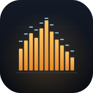
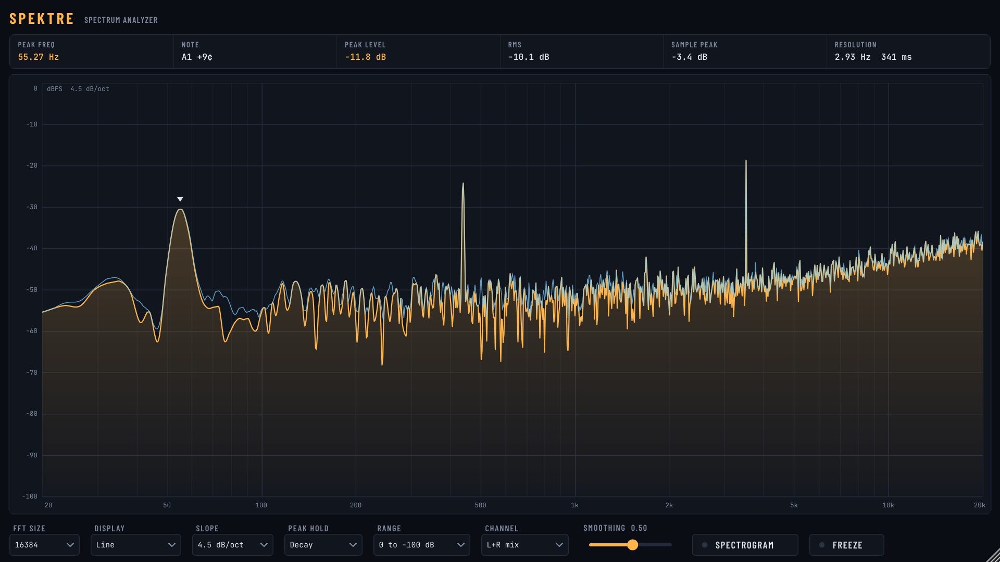

<p align="center">
  
</p>

# SPEKTRE VST3

The [Spektre](https://github.com/TheoGal/spektre) spectrum analyzer as a VST3 plugin, built with JUCE. Put it on any track or bus in your DAW: the audio passes through untouched and Spektre shows its spectrum.


<!-- placeholder: add docs/screenshot.png -->

### disclaimer
Im into web developing the last 10 years but this app was 100% vibe-coded with Claude - I simply inspected the code afterwards.

## Features

- **Calibrated dBFS:** a 0 dBFS sine reads 0 dB, the same math as the web version.
- **Precise peak readout:** interpolated peak frequency and level, with the note name and cents.
- **Display modes:** line, or 1/3, 1/6 and 1/12-octave bars, with optional peak hold (decay or max).
- **Live stats:** RMS and sample-peak meters.
- **Resolution control:** FFT size from 2048 to 32768, with the bin resolution shown live.
- **Analysis options:** dB/oct slope, channel select (L+R, Left or Right), smoothing, display range and freeze.
- **Spectrogram:** an optional scrolling view under the main plot.
- **Cursor readout:** hover the plot for frequency, level and note.
- **Remembers its view:** settings are saved with your project, per plugin instance.
- **Resizable window.**

### dB/oct slope setting

Music naturally carries far more energy in the low end, so a flat (unsloped) spectrum of a well-balanced mix falls steeply from left to right. That makes tonal balance hard to judge.

Tilting the display by 4.5 dB per octave (the default) makes a balanced mix look roughly flat. It's the same convention as the default slope in Voxengo SPAN and other mixing analyzers.

The slope changes only the plot. The peak level and cursor readouts always show the true, unsloped dBFS.

## Install (Windows)

1. Download `Spektre-Windows-x64.zip` from the [latest release](https://github.com/TheoGal/spektre-vst/releases/latest).
2. Copy the `Spektre.vst3` folder to `C:\Program Files\Common Files\VST3\`.
3. Rescan plugins in your DAW. Spektre shows up as an effect (category: Analyzer).

The zip also contains `Spektre.exe`, a standalone version that analyzes your audio input device.

## Build it yourself

You need CMake 3.22+ and a C++17 compiler (Visual Studio 2022 on Windows). JUCE is downloaded automatically.

```
cmake -S . -B build
cmake --build build --config Release --target Spektre_VST3
```

The plugin ends up in `build/Spektre_artefacts/Release/VST3/`.

Every push to GitHub builds the Windows version automatically (see the Actions tab). Pushing a tag like `v1.0.0` also publishes a release with the zip attached.

### Tests

`cmake -S . -B build -DSPEKTRE_BUILD_TESTS=ON` adds a test program that feeds known sine waves through the plugin and checks the readings (level within 0.1 dB, frequency within 0.5 Hz), checks state save and restore, and renders the UI to PNG.

## License

AGPLv3, because Spektre uses the JUCE framework under its open-source (AGPLv3) license. In short: use, share and modify it freely, but changes you distribute must stay open source under the same license.

The bundled fonts (Barlow Condensed, JetBrains Mono) are under the SIL Open Font License, see `Resources/fonts/`.
